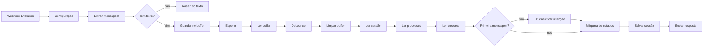

# Bot de WhatsApp para escritório de advocacia

Atendimento automático para credores de processos de recuperação judicial, falência e dissolução societária. A pessoa escolhe o processo pelo WhatsApp e consulta o andamento ou a situação do próprio crédito, sem precisar ligar pro escritório.

Feito com n8n, Evolution API, Redis e Google Sheets. É uma versão genérica, escrita do zero, de um bot que montei para uma administradora judicial. Nomes, processos e documentos daqui são fictícios.

## Como é a conversa

```
Cliente: oi
Bot:     Olá, João! Aqui é o atendimento automático do Escritório Exemplo Advocacia.
         Sobre o que você quer saber?
         1. Andamento de um processo
         2. Situação do meu crédito
         3. Falar com a equipe
Cliente: 2
Bot:     Qual o tipo do processo?
         1. Dissolução Societária
         2. Falência
         3. Recuperação Judicial
Cliente: recuperação
Bot:     Em qual estado corre o processo?
         1. PB
         2. PE
Cliente: PE
Bot:     Qual a empresa?
         1. Construtora Beta S.A.
         2. Transportes Alfa Ltda
Cliente: transportes
Bot:     Para consultar o seu crédito no processo de *Transportes Alfa Ltda*,
         informe o CPF ou CNPJ do credor (só números).
Cliente: 12345678909
Bot:     Crédito encontrado para ***.456.***-**:
         Classe: Trabalhista
         Valor: R$ 12.450,00
         Situação: 1ª parcela paga em 15/10/2026
```

Se a primeira mensagem já diz o que a pessoa quer ("quero saber do meu crédito"), o bot pula o menu e vai direto pro fluxo.

## Decisões de arquitetura

**Máquina de estados, não agente de IA.** A primeira versão do bot original era um agente de IA com ferramentas pra buscar no Drive. Ele nem sempre chamava a ferramenta de busca, perdia o contexto entre uma mensagem e outra e às vezes respondia sem consultar a planilha. Pra um bot que informa valor de crédito, isso não serve. Na versão final o fluxo é fixo e a IA só classifica a primeira mensagem livre em `andamento`, `credito`, `contato` ou `outro`. Se a IA falhar ou demorar, o bot segue mostrando o menu.

**Nenhuma resposta sai de texto gerado.** Tudo que o bot fala de processo ou crédito vem da planilha.

**Debounce.** Muita gente escreve "oi", "tudo bem?" e "quero ver meu processo" em três mensagens seguidas. Cada mensagem vai pra uma lista no Redis, o fluxo espera alguns segundos e só a execução da última mensagem continua, com o texto das três junto. Sem isso o cliente recebe três menus.

**Filtro de `fromMe`.** A mensagem que o próprio bot envia volta pelo webhook da Evolution. Sem esse filtro o bot responde a si mesmo em loop.

**Sessão no Redis com expiração.** O estado da conversa (em que pergunta a pessoa está, qual processo escolheu) fica em `sessao:<instancia>:<numero>` com validade de 30 minutos.

## Cuidados com dado de credor

- CPF/CNPJ é validado pelos dígitos verificadores antes de qualquer busca.
- Depois de 3 documentos inválidos, a consulta de crédito fica bloqueada por 30 minutos, o que dificulta tentar documentos no chute.
- O documento aparece mascarado na resposta (`***.456.***-**`) e não é salvo na sessão.
- A resposta é a mesma pra "documento não existe" e "documento existe em outro processo". O bot não confirma em quais processos um CPF aparece.
- O bot só responde sobre o processo escolhido, nunca lista credores.

Isso reduz exposição, mas não substitui uma análise de LGPD do escritório. Quem tem o CPF de alguém consegue consultar o crédito dessa pessoa. Se isso for um problema pro caso, o próximo passo é confirmar o número de WhatsApp cadastrado do credor antes de responder.

## Estrutura

```
src/
├── mensagem.js    # lê o webhook da Evolution, filtra fromMe/grupos, debounce
├── documento.js   # valida e mascara CPF/CNPJ
└── maquina.js     # o fluxo da conversa (função pura, sem rede)
scripts/
└── build-workflow.js   # gera n8n/workflow.json com o código de src/ dentro dos nós
n8n/
└── workflow.json       # pronto pra importar
exemplo/
└── dados.json          # processos e credores fictícios
test/
```

O código dos nós Code do n8n é gerado a partir de `src/`. Assim a lógica que roda no n8n é exatamente a que os testes cobrem.

## Fluxo no n8n



## Como usar

1. **Planilha.** Crie uma planilha no Google Sheets com duas abas:
   - `processos`: `id`, `tipo`, `uf`, `empresa`, `andamento`, `atualizado_em`
   - `credores`: `processo_id`, `documento`, `nome`, `classe`, `valor`, `situacao`

   Formate a coluna `documento` como **texto**. Se ficar como número, CPF que começa com zero perde o zero e a busca falha. Os dados de `exemplo/dados.json` servem de modelo.

2. **Importar.** No n8n: *Workflows > Import from file* > `n8n/workflow.json`.

3. **Credenciais.** Crie e associe nos nós:
   - *Header Auth* com nome `apikey` e a chave da Evolution (nós de envio);
   - *Header Auth* com nome `x-goog-api-key` e a chave do Gemini (nó da IA);
   - *Redis*;
   - *Google Sheets OAuth2*.

4. **Configuração.** No nó *Configuração*, preencha os dados do escritório, a URL da Evolution e o ID da planilha.

5. **Webhook na Evolution.** Aponte o webhook da instância pra URL de produção do nó *Webhook Evolution*, com o evento `MESSAGES_UPSERT`. Se a opção *Webhook by Events* estiver ligada, a Evolution acrescenta `/messages-upsert` no fim da URL e o caminho deixa de bater.

6. **Ativar** o workflow.

## Testar

```
npm test
```

Os testes simulam conversas inteiras e também executam o código gerado dos nós do n8n com entradas falsas.

Pra testar o webhook sem celular (no Windows `cmd`, use aspas duplas escapadas; aspas simples quebram o JSON):

```
curl -X POST "https://SEU_N8N/webhook/bot-advocacia" -H "Content-Type: application/json" -d "{\"event\":\"messages.upsert\",\"instance\":\"bot\",\"data\":{\"key\":{\"remoteJid\":\"5581999990000@s.whatsapp.net\",\"fromMe\":false,\"id\":\"TESTE1\"},\"pushName\":\"Teste\",\"message\":{\"conversation\":\"oi\"}}}"
```

## Quando der erro

| Sintoma | Onde olhar |
|---|---|
| `curl` responde 404 | Workflow não está ativo, ou o path está diferente. |
| Teste funciona e produção não | Confira se o host da URL de produção existe no DNS (`nslookup`). A variável `WEBHOOK_URL` do n8n pode estar apontando pra um subdomínio que não existe. |
| Bot responde a si mesmo | O filtro de `fromMe` não está pegando: veja o JSON cru do webhook na execução. |
| Três respostas pra três mensagens | O debounce não está funcionando: confira com `KEYS buffer:*` no Redis se a chave tem o número e não `undefined`. |
| "Não encontramos crédito" pra documento que existe | A coluna `documento` está como número na planilha, ou o `processo_id` não bate com o `id` do processo. |
